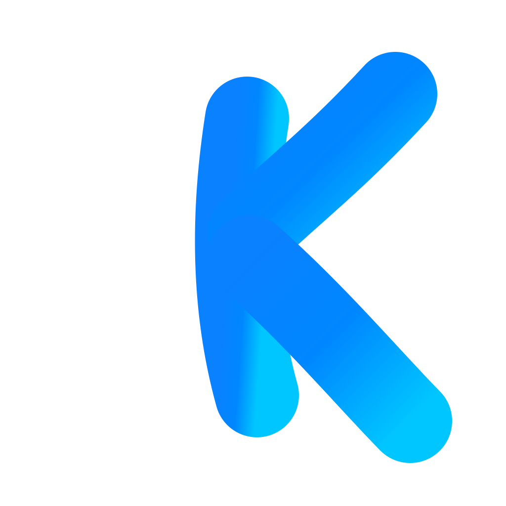
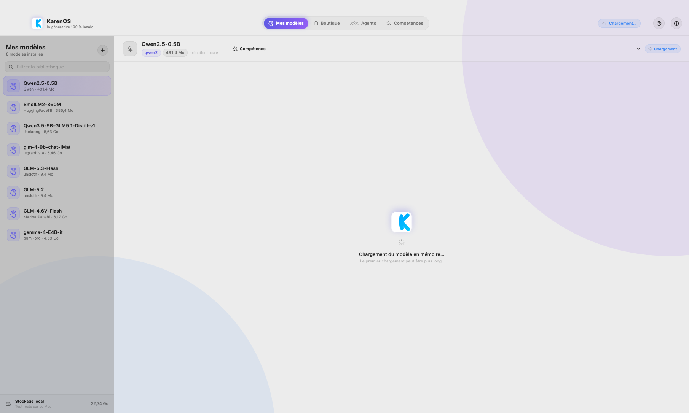
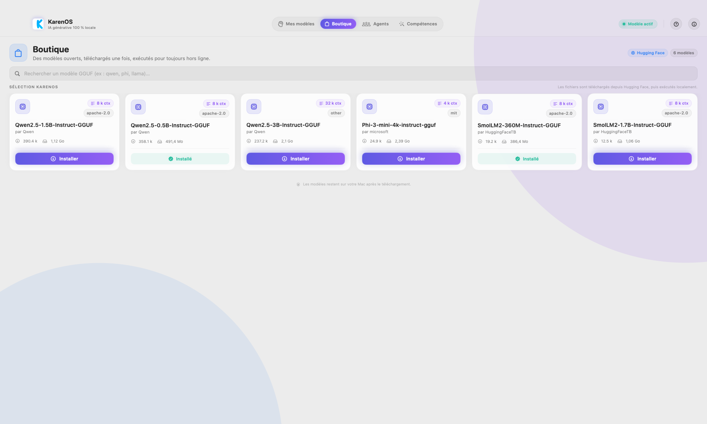
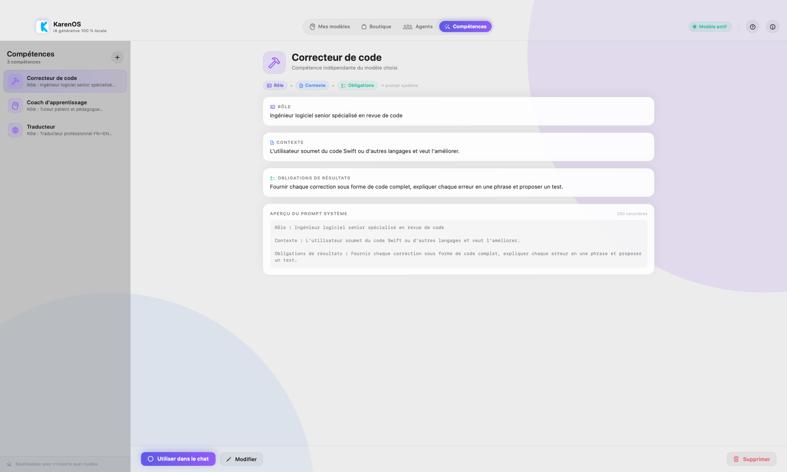
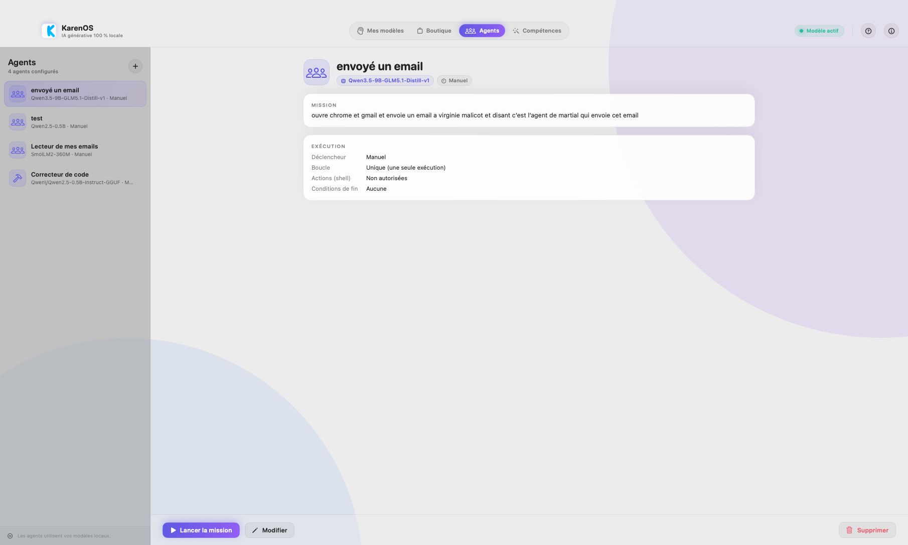

# KarenOS

<p align="center">
  
</p>

<!--
    SEO — KarenOS · Référence projet : https://github.com/martialzinsou/KarenOs
    Canonical : https://github.com/martialzinsou/KarenOs
    Auteur   : Martial Zinsou
    Fonction : Directeur des Systèmes d'Information (DSI / IT Director)
    Titre    : KarenOS — Application native macOS d'IA générative 100% locale
    Description : KarenOS est une application macOS native permettant de télécharger des modèles GGUF depuis Hugging Face et de discuter avec eux entièrement en local. Chat en streaming via llama.cpp, agents autonomes, multimodal (images, vidéo, audio, dictée vocale), compétences réutilisables. Aucune donnée ne quitte la machine. Idéal pour DSI, IT Directors, gouvernance IT, infrastructure IA souveraine.
    Mots-clés : karenos, ia locale, ia hors ligne, macos, swift, swiftui, llama.cpp, gguf, hugging face, agents ia autonomes, multimodal, chatbot local, martial zinsou, dsi, directeur informatique, it director, gouvernance it, transformation digitale, infrastructure ia, ia souveraine, llm local, generative ai local
    Langue   : fr
    robots   : index, follow
    og:title : KarenOS — IA générative 100% locale pour macOS
    og:description : Téléchargez des modèles GGUF depuis Hugging Face et discutez avec eux entièrement en local. Agents autonomes, multimodal, compétences, zéro donnée sortante.
    og:type : website
    og:url : https://github.com/martialzinsou/KarenOs
    og:image : https://raw.githubusercontent.com/martialzinsou/KarenOs/main/docs/branding/karenos-logo.png
    twitter:card : summary_large_image
    twitter:title : KarenOS — IA locale macOS
    twitter:description : Application native macOS d'IA générative 100% locale avec agents autonomes et multimodal.
-->


Application native macOS pour utiliser des modèles d'IA **en local** : téléchargement de modèles GGUF depuis Hugging Face, puis discussion avec eux, tout sur ta machine.

**Auteur : Martial Zinsou**

## Captures d'écran



*Mes modèles : bibliothèque et chat en local.*



*Boutique : parcours et installation de modèles GGUF depuis Hugging Face.*



*Compétences : consignes réutilisables avec n'importe quel modèle.*



*Agents : missions autonomes sur un modèle choisi, avec déclencheur, boucle infinie et conditions de fin.*

## Fonctionnalités

- **Boutique** : modèles GGUF sélectionnés (Qwen 0.5B à 3B, SmolLM, Phi-3…) + recherche sur Hugging Face avec indicateur de taille, licence et contexte.
- **Mes modèles** : modèles installés, chargement, discussion en streaming (réponses token par token).
- **Agents** : missions autonomes — décrivez la mission, choisissez le modèle, le **déclencheur** (manuel, au lancement, toutes les X secondes), la **boucle infinie** et des **conditions de fin** (nombre d'itérations, durée, mot-clé de réussite). Le modèle est chargé automatiquement puis le précédent est restauré.
- **Multimodal** : joignez des **images, vidéos, fichiers audio** à vos messages et **dictez votre voix** (reconnaissance vocale locale). En présence d'un modèle vision (`*.mmproj`), les images sont réellement analysées par le modèle.
- **Compétences** : consignes structurées (rôle, contexte, obligations de résultats) appliquées automatiquement quel que soit le modèle.
- **Moteur local** : `llama-server` (llama.cpp b8967) **embarqué** dans l'app et recompilé pour macOS 11. Aucune donnée ne quitte l'ordinateur.

📘 **Documentation complète** — architecture, schémas d'inférence, flux des compétences, dépannage : [docs/DOCUMENTATION.md](docs/DOCUMENTATION.md) → &nbsp; **🇺🇸 English (US) :** [DOCUMENTATION_EN.md](docs/DOCUMENTATION_EN.md) →

## Pré-requis

- macOS 11 (Big Sur) ou plus récent — Intel x64 ; sur Apple Silicon, l'app et le moteur embarqué (x86_64) s'exécutent via Rosetta 2
- Outils de ligne de commande (`xcode-select --install`). Xcode n'est pas obligatoire.

## Construire et lancer

```bash
Scripts/make-app.sh          # compile + assemble build/KarenOS.app
Scripts/make-app.sh --run    # compile puis ouvre l'app
Scripts/make-icon.sh         # (re)génère la belle icône Packaging/KarenOS.icns
```

Le portage macOS 11 (substitutions SwiftUI, runtime de concurrence embarqué, reconstruction de llama.cpp) est documenté dans [docs/BIG-SUR.md](docs/BIG-SUR.md), avec un test de bout en bout sans interaction :

```bash
KARENOS_SMOKE_MODEL="HuggingFaceTB/SmolLM2-360M-Instruct-GGUF" \
KARENOS_SMOKE_OUT=/tmp/karen_smoke.txt \
  build/KarenOS.app/Contents/MacOS/KarenOS
```

## Utilisation

1. Ouvrir **Boutique** → choisir un modèle (les petits modèles sont en haut de liste) → **Installer**.
2. Aller dans **Mes modèles** → cliquer sur le modèle → le chat se charge automatiquement.
3. Écrire un message et discuter. Tout est local (contexte de 2048 tokens, réponse limitée à 512 tokens par défaut, modifiable dans le code).

Au premier lancement, l'app utilise le moteur d'inférence embarqué (`llama.cpp` b8967, recompilé pour macOS 11) ; sur macOS 12+, elle peut aussi télécharger l'archive officielle (~8 Mo) dans `~/Library/Application Support/KarenOS/`.

## Détails techniques

- 100 % Swift / SwiftUI, aucune dépendance externe.
- API Hugging Face (recherche, détails, téléchargement avec progression).
- `llama-server` (llama.cpp) lancé en sous-processus, interface HTTP de type OpenAI (`/v1/chat/completions`), streaming SSE.
- Compilation directe avec `swiftc` (pas d'Xcode requis).

## Notes

- L'inférence se fait sur CPU via BLAS/`Accelerate` ; le moteur embarqué n'active pas Metal (ce backend ne couvre pas les GPU Intel de Big Sur).
- Les modèles vont directement dans `~/Library/Application Support/KarenOS/Models/`.
- La section **About** contient une description et des tags, et tous les fichiers `.md` s'affichent proprement sur la page d'accueil du dépôt.